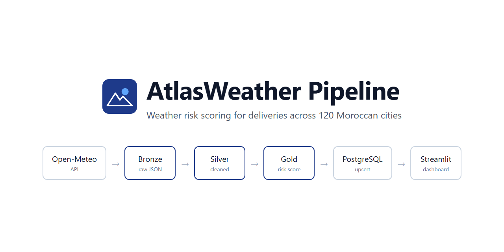
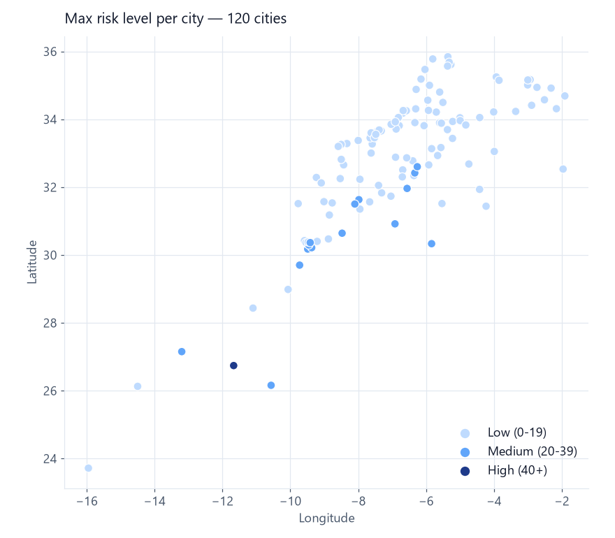
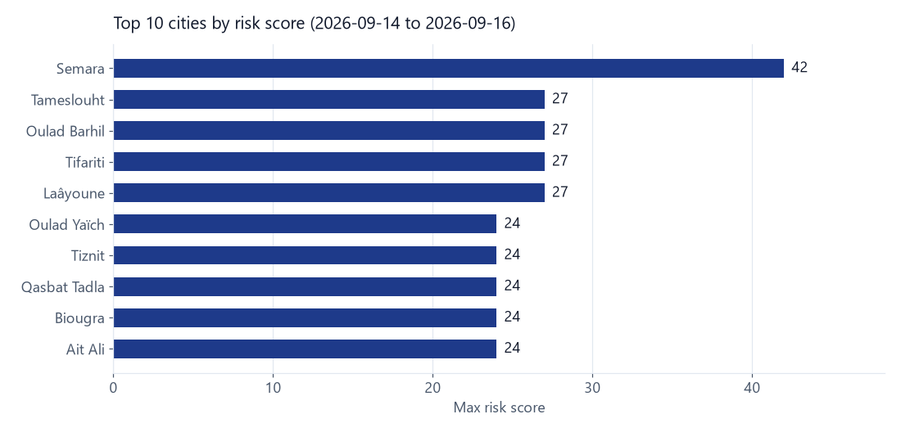

<p align="center">
  
</p>

# AtlasWeather Pipeline

An end-to-end data pipeline that fetches 3-day weather forecasts for 120 Moroccan cities,
cleans them, scores each day for delivery risk (0 to 100) and loads the result into
PostgreSQL. Airflow runs it daily and a Streamlit dashboard shows the results.

## Architecture

The pipeline follows the medallion pattern:

| Layer | Script | Output |
|---|---|---|
| Bronze | `extraction/extract_weather.py` | Raw Open-Meteo JSON per city in `bronze/` |
| Silver | `transformation/transform_weather.py` | Cleaned, typed and deduplicated data in `silver/data.csv` |
| Gold | `gold/gold.py` | Weather categories and risk score in `gold/data.csv` |
| Load | `load/loader.py` | `cities` and `weather_forecast` tables in PostgreSQL |

- **Extraction**: each API call is retried up to 4 times; a city that keeps failing is skipped instead of stopping the run.
- **Silver checks**: duplicates, negative precipitation, abnormal temperatures and coordinates outside Morocco. The data is then merged with city region and population from `data/ma-cities.csv`.
- **Load**: upserts with `ON CONFLICT DO UPDATE` on `(city_id, date)`, so re-running the pipeline never creates duplicates.

## Risk score

Each forecast day gets points for every weather hazard, capped at 100:

| Factor | Condition | Points |
|---|---|---|
| Precipitation | >= 20 mm / >= 5 mm / > 0 mm | 30 / 10 / 5 |
| Wind speed | >= 60 km/h / >= 40 km/h / >= 20 km/h | 25 / 15 / 5 |
| Wind gusts | >= 80 km/h / >= 50 km/h / >= 30 km/h | 20 / 12 / 4 |
| Max temperature | >= 45 °C / >= 38 °C / <= 0 °C | 15 / 10 / 8 |
| Rain probability | >= 70 % / >= 40 % | 10 / 5 |

Risk levels: **Low** below 20, **Medium** 20 to 39, **High** 40 and above.

## Results

Sample run with forecasts from 2026-09-14 to 2026-09-16 (360 rows, 120 cities):

<p align="center">
  
</p>

<p align="center">
  
</p>

## Setup

Requirements: Python 3.11, Docker and Docker Compose.

```bash
git clone https://github.com/eliasdeva/atlasweather-pipeline.git
cd atlasweather-pipeline
cp .env.example .env
```

Fill in `.env` with your PostgreSQL user, password, database and port.

## Run with Docker

```bash
docker compose up -d
docker exec -i atlas-pgsql psql -U <user> -d <database> < sql/schema.sql
```

| Service | URL |
|---|---|
| Streamlit dashboard | http://localhost:8501 |
| Airflow | http://localhost:8080 |

Airflow runs in standalone mode. The login is printed in the logs:
`docker compose logs airflow | grep -i password`.

## Run locally

```bash
python -m venv venv
.\venv\Scripts\activate        # Windows
source venv/bin/activate       # Linux / macOS
pip install -r requirements.txt

docker compose up -d postgres
docker exec -i atlas-pgsql psql -U <user> -d <database> < sql/schema.sql

python extraction/extract_weather.py
python transformation/transform_weather.py
python gold/gold.py
python load/loader.py

streamlit run dashboard/app.py
```

## Airflow

The DAG `atlasweather_pipeline` in `dags/weather_dag.py` runs the four steps in order:

```text
extract_weather_bronze >> transform_weather_silver >> feature_engineering_gold >> load_to_postgres
```

It runs `@daily` without catchup, with 2 retries 2 minutes apart. To trigger it manually:

```bash
docker exec -it atlas-airflow airflow dags trigger atlasweather_pipeline
```

## Dashboard

- Filters by city, date and risk level.
- KPIs: cities tracked, max temperature, max rainfall, risk periods and highest-risk city.
- Bar chart of the 10 riskiest cities and a full forecast table.

## SQL queries

`sql/queries.sql` contains five analysis queries:

1. Hottest cities
2. Rainiest cities
3. Cities with the highest average risk
4. Dates with the highest risk
5. Highest-risk day for each city (`DISTINCT ON`)

## Project structure

```text
atlasweather-pipeline/
├── assets/                  # README images
├── data/ma-cities.csv       # 120 Moroccan cities with coordinates and population
├── extraction/              # Bronze: API extraction
├── transformation/          # Silver: cleaning and quality checks
├── gold/                    # Gold: categories and risk score
├── load/                    # PostgreSQL loader
├── dags/                    # Airflow DAG
├── dashboard/               # Streamlit app
├── sql/                     # Schema and analysis queries
├── docker-compose.yml       # PostgreSQL, Airflow and Streamlit
└── requirements.txt
```

## Useful commands

| Task | Command |
|---|---|
| Container status | `docker compose ps` |
| Follow logs | `docker compose logs -f airflow` |
| Stop everything | `docker compose down` |
| Reset the database | `docker compose down -v` |
| Open psql | `docker exec -it atlas-pgsql psql -U <user> -d <database>` |
